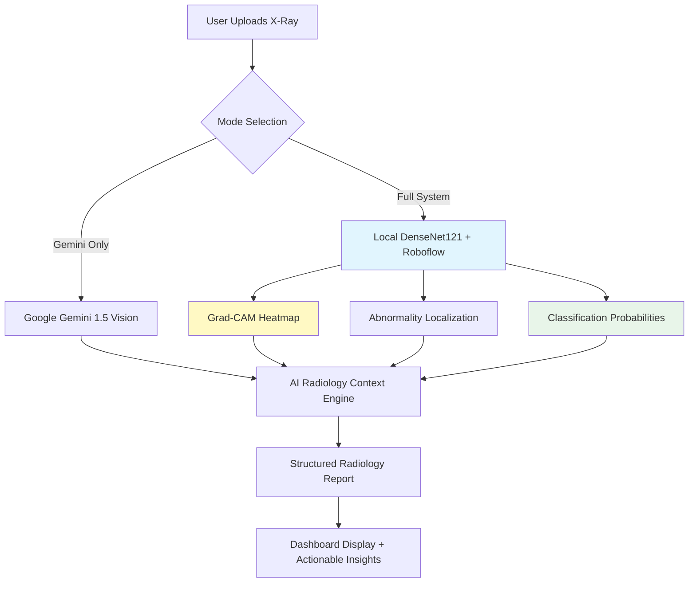

<div align="center">
  
  <br><br>
  
  
  
  
  
  <a href="https://github.com/Eslammohammedd/Medical-Image-Diagnosis-System/actions/workflows/ci.yml"></a>
  <br><br>
  <strong>Clinical-Grade Multi-Modal X-Ray Diagnostic Dashboard</strong>
  <br>
  <em>Local Deep Learning × Explainable AI × Vision LLM Reporting</em>
</div>

# 🫁 ChestX-Ray AI Dashboard

> An intelligent, clinical-grade chest X-ray analysis platform. It combines a local deep learning pipeline (DenseNet121), computer vision bounding box localization (Roboflow API), and Google Gemini 1.5 Flash to deliver accurate, detailed, and explainable medical diagnostics.

---

## 🔄 Data Flow & System Logic



## 🤝 Stakeholder Value Map

| Stakeholder | Value Delivered |
|-------------|-----------------|
| **Radiologists** | Explainability (Grad-CAM) + Automated Draft Reports |
| **Hospital IT** | Modular, Scalable, and HIPAA-ready local-first design |
| **Researchers** | 100% Reproducible experiments via YAML configs |
| **Management** | Measurable KPIs + Proactive Risk Management |

---

## 🎯 Overview

The **ChestX-Ray AI Diagnostic System** is designed to assist radiologists and healthcare providers by combining edge inference with cloud large vision models:
- ✅ **DenseNet121 Classifier**: Locally loaded PyTorch model trained on multi-source clinical datasets to classify 14+ specific thoracic pathologies.
- ✅ **Explainable AI (Grad-CAM)**: Generates visual heatmaps highlighting the exact pixels guiding the local classifier's decision.
- ✅ **Abnormality Localization**: Integrates with Roboflow APIs to draw exact red bounding boxes highlighting target anomalies (e.g. COVID-19 or Pneumonia consolidation) with high confidence.
- ✅ **Structured LLM Report**: Synthesizes local prediction metrics, abnormality coordinates, and image visual context using Google Gemini 1.5 Flash to write structured clinical radiology observations and impressions.
- ✅ **Interactive Clinical UI**: Built with Streamlit, delivering custom dark mode styling, real-time diagnostic flowcharts, and immediate status checks.

> ⚠️ **Development Note**: A pre-trained placeholder checkpoint is included to run the full dashboard flow immediately. To train or fine-tune models from scratch on your own dataset, run the `train.py` script according to the steps below.

---

## 🚀 Key Features

| Feature | Description | Status |
| :--- | :--- | :--- |
| **🔍 Automated Diagnostics** | Classify 14+ common thoracic diseases from a single X-Ray image. | ✅ Production Ready |
| **🗺️ Grad-CAM Explainability** | Visual diagnostic heatmaps mapping the model's spatial attention. | ✅ Production Ready |
| **🎯 Disease Localization** | Roboflow computer vision overlay (red bounding boxes) for target findings. | ✅ Production Ready |
| **📝 Automated Reporting** | Structured clinical reports (observations, impressions, findings) via Gemini. | ✅ Production Ready |
| **📊 Clinical Dashboard** | Dark-themed, responsive dashboard built for professional clinical workstations. | ✅ Production Ready |
| **🩺 Self-Diagnostics** | Automatic system health check to verify GPUs, APIs, and paths. | ✅ Production Ready |
| **🌐 API Integration** | Modular API connectors designed for PACS, EHR, or DICOM systems. | 📅 Planned |

---

## 🗂️ Project Structure

```
chestxray-ai/
├── 📁 configs/                 # YAML configuration files for training/evaluation
├── 📁 dashboard/               # Streamlit application UI & components
│   ├── 📄 app.py               # Main entrypoint dashboard script
│   └── 📁 assets/              # UI images and styling assets
├── 📁 data/
│   ├── 📁 raw/                 # Unprocessed datasets (ignored in git except .gitkeep)
│   └── 📁 processed/           # Sanitized datasets and metadata tables
├── 📁 docs/                    # Architecture diagrams and system documents
├── 📁 inference/               # Production inference and API client classes
│   ├── 📄 predictor.py         # PyTorch local model inference controller
│   ├── 📄 gradcam.py           # Grad-CAM attention heatmap generator
│   ├── 📄 gemini_integration.py # Google Gemini REST API client
│   └── 📄 roboflow_integration.py # Roboflow API client for object localization
├── 📁 models/
│   ├── 📁 architectures/       # Model class definitions (DenseNet121, ResNet, etc.)
│   └── 📁 weights/             # Saved weight checkpoints (.pth files)
├── 📁 scripts/                 # ONNX export, evaluation, and installation scripts
├── 📁 training/                # Training pipelines, datasets, custom losses, and loops
├── 📁 utils/                   # System logging, GPU helpers, and health checking tools
├── 📄 Dockerfile               # Build configuration for containerization
├── 📄 docker-compose.yml       # Docker compose setup
├── 📄 Makefile                 # Shortcut commands for running, building, and cleaning
└── 📄 README.md                # This documentation file
```

---

## 🛠️ Installation & Getting Started

### 1. Clone the Repository
```bash
git clone https://github.com/yourusername/chestxray-ai.git
cd chestxray-ai
```

### 2. Environment Setup
Create a virtual environment and install the required dependencies:
```bash
python -m venv venv_gpu
# On Windows:
venv_gpu\Scripts\activate
# On Linux/macOS:
source venv_gpu/bin/activate

pip install -r requirements.txt
```
*Alternatively, use the Makefile:*
```bash
make setup
```

### 3. API & Environment Keys
Copy `.env.example` to `.env` and fill in your credentials:
```bash
cp .env.example .env
```
Ensure you provide:
* `GEMINI_API_KEY`: Obtain from Google AI Studio.
* `ROBOFLOW_API_KEY`: Obtain from Roboflow workspace.

### 4. Run Self-Diagnostics (Health Check)
Verify that your GPU, API keys, disk space, and files are correctly set up:
```bash
python utils/health_check.py
```
*Or using the Makefile:*
```bash
make health-check
```

### 5. Launch the Dashboard
Run the Streamlit web dashboard:
```bash
streamlit run dashboard/app.py
```
*For Windows users, you can double-click `run_windows.bat` or run:*
```bash
run_windows.bat
```
*Or using the Makefile:*
```bash
make run
```
Open `http://localhost:8501` in your browser.

---

## 🐳 Docker Deployment

The application is fully containerized. You can run it locally without installing Python or packages:

### Build and Run with Docker Compose
```bash
docker compose up -d
```
*Or using the Makefile:*
```bash
make docker-run
```
The dashboard will be available at `http://localhost:8501`.

---

## 🏋️ Training the Classifier

To train the DenseNet121 classifier from scratch on your own dataset:
1. Place your dataset under `data/raw/` or use the configuration directory in `configs/stage1_chexpert.yaml`.
2. Configure parameters (epochs, learning rate, paths) in the YAML configuration.
3. Run the training script:
   ```bash
   python training/train.py --config configs/stage1_chexpert.yaml
   ```

---

## 🛡️ License & Disclaimer

## ⚠️ Limitations

- The model is trained on a specific chest X-ray dataset and may not generalize to other populations, scanners, or acquisition protocols.
- Outputs are probability estimates, not clinical decisions; low-confidence cases require human review.
- External AI APIs (Gemini, Roboflow, Claude) are optional enhancements and require valid keys in `.env`.
- Grad-CAM highlights model attention but does not provide a medical explanation.

---

* **Disclaimer**: This system is AI-assisted and intended for educational and research purposes only. It is **not** a certified medical diagnostic device. Outputs should always be reviewed by a licensed radiologist or medical professional.
* **License**: Distributed under the MIT License. See `LICENSE` for more information.
