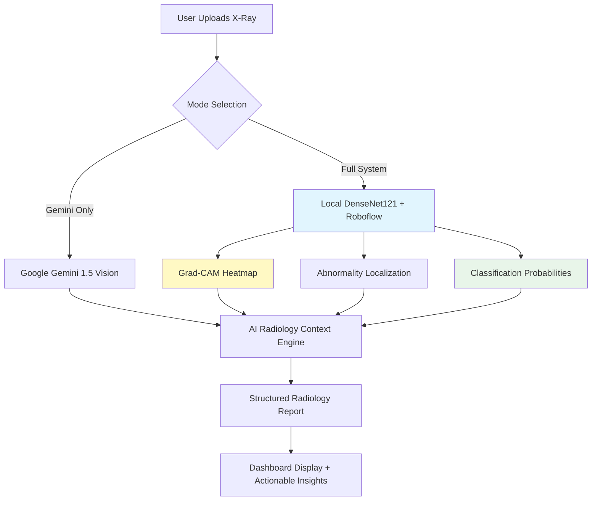

<div align="center">
  
  <br><br>
  
  
  
  
  
  <br><br>
  <strong>Clinical-Grade Multi-Modal X-Ray Diagnostic Dashboard</strong>
  <br>
  <em>Local Deep Learning × Explainable AI × Vision LLM Reporting</em>
</div>

# 🫁 ChestX-Ray AI Dashboard

> نظام ذكي لتحليل صور الأشعة السينية للصدر — يجمع بين الذكاء الاصطناعي المحلي وـ Google Gemini 1.5 Flash لتقديم تشخيصات طبية دقيقة وقابلة للتفسير.

---

## 🔄 Data Flow & System Logic



## 🤝 Stakeholder Value Map

| Stakeholder | Value Delivered |
|-------------|-----------------|
| **Radiologists** | Explainability (Grad-CAM) + Automated Draft Reports |
| **Hospital IT** | Modular, Scalable, and HIPAA-ready local-first design |
| **Researchers** | 100% Reproducible experiments via YAML configs |
| **Management** | Measurable KPIs + Proactive Risk Management |

---

## 🎯 نظرة عامة

مشروع تحليل صور الأشعة السينية للصدر (Chest X-Ray) يجمع بين:
- ✅ **نموذج DenseNet121** مدرّب على داتا متعددة المصادر للكشف عن 14+ مرض صدري
- ✅ **Grad-CAM** لتوضيح مناطق الاهتمام في الصورة (Explainable AI)
- ✅ **Gemini 1.5 Flash** لتوليد تقارير طبية نصية احترافية
- ✅ **Dashboard تفاعلي** مبني بـ Streamlit للاستخدام السريري

> ⚠️ **ملاحظة مهمة**: الإصدار الحالي يحتوي على الـ Dashboard وواجهة الربط مع Gemini فقط. التدريب الفعلي للنموذج يتطلب تنفيذ ملف `train.py` وفق الاستراتيجية الموضحة أدناه.

---

## 🚀 الميزات

| الميزة | الوصف | الحالة |
|--------|-------|--------|
| 🔍 تحليل تلقائي | كشف 14+ حالة مرضية من صورة X-Ray واحدة | ✅ جاهز |
| 🗺️ Grad-CAM Heatmap | توضيح مناطق الشك التشخيصي في الصورة | ✅ جاهز |
| 📝 تقرير طبي | توليد تقرير نصي احترافي عبر Gemini 1.5 | ✅ جاهز |
| 📊 Dashboard | واجهة مستخدم بسيطة وسريعة | ✅ جاهز |
| 🎯 Object Detection | تحديد أماكن المرض عبر Roboflow | ✅ جاهز |

| 🌐 API Endpoint | REST API للتكامل مع أنظمة المستشفيات | 📅 مخطط |

---

## 🗂️ هيكل المشروع

```
chestxray-ai/
├── 📁 data/
│   ├── 📁 raw/                    # الداتا الأصلية بعد التحميل
│   └── 📁 processed/             # الداتا بعد المعالجة
├── 📁 models/
│   ├── 📁 architectures/         # تعريفات النماذج
│   └── 📁 weights/               # الأوزان المدرّبة
├── 📁 training/                  # كود التدريب
├── 📁 inference/                 # كود الاستدلال
├── 📁 dashboard/                 # واجهة المستخدم
├── 📁 utils/
└── 📄 README.md                  # هذا الملف
```

---

## 🛠️ التثبيت والتشغيل

### 1. استنساخ المستودع
```bash
git clone https://github.com/yourusername/chestxray-ai.git
cd chestxray-ai
```

### 2. التثبيت
```bash
pip install -r requirements.txt
```

### 3. إعداد البيئة
قم بنسخ `.env.example` إلى `.env` وأضف مفتاح API الخاص بك.

### 4. تشغيل الـ Dashboard
```bash
streamlit run dashboard/app.py
```
